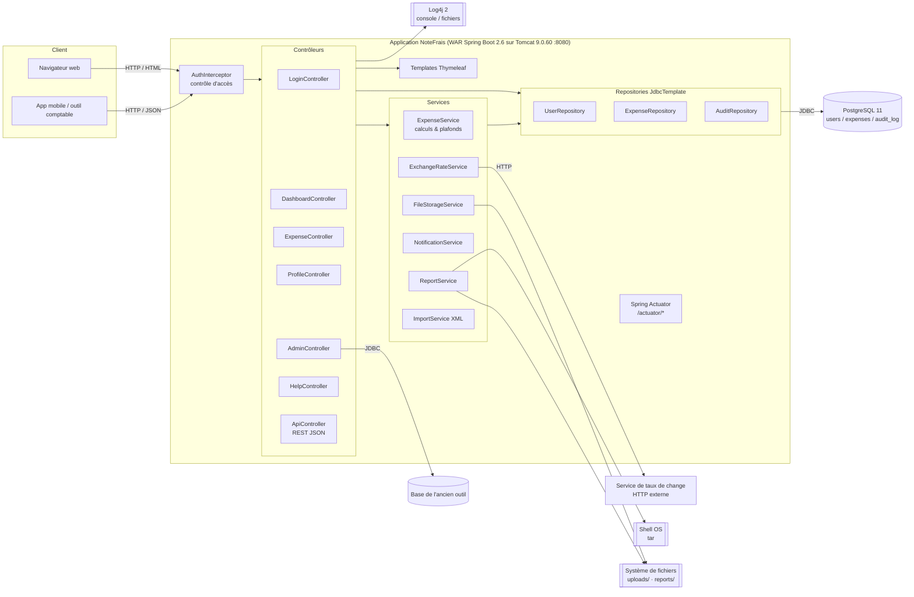
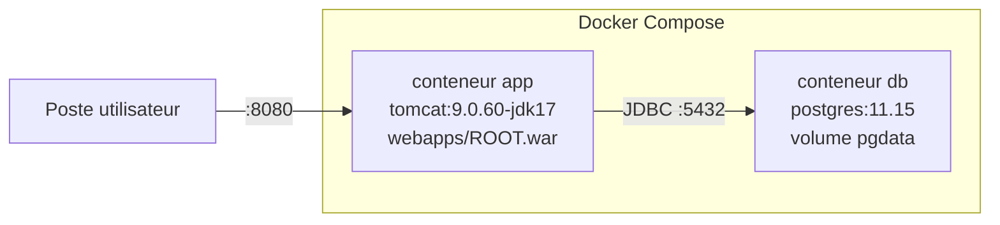
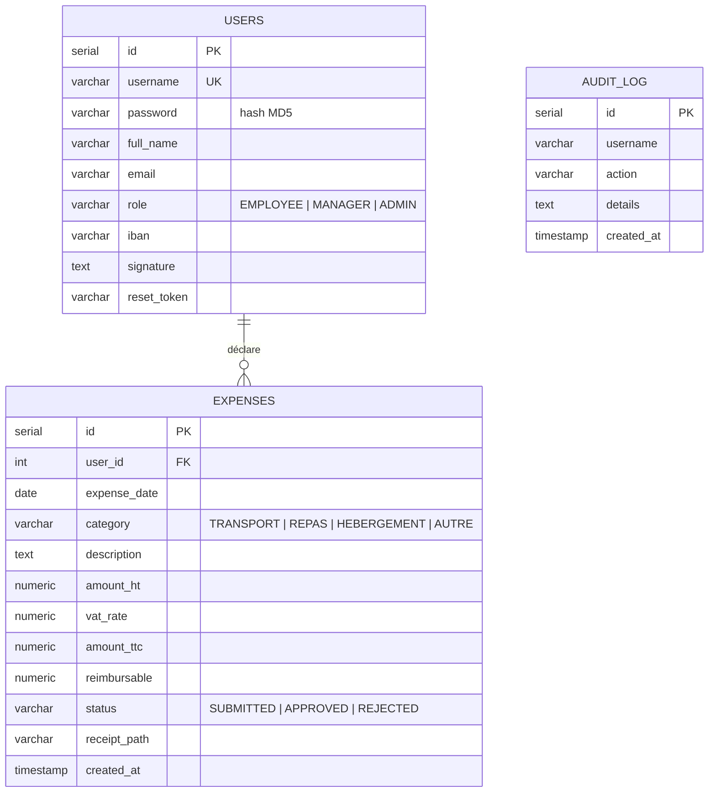
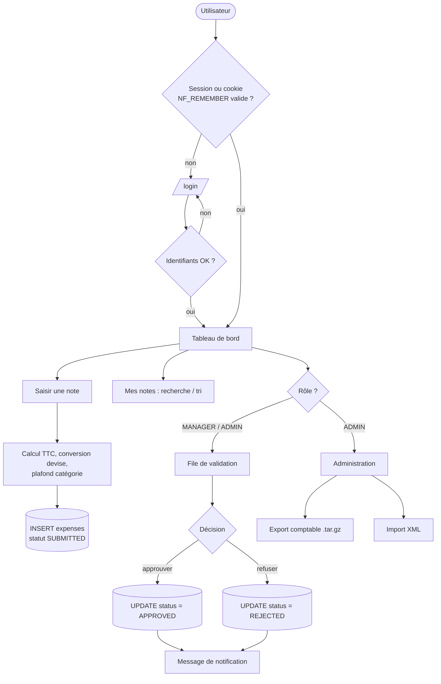
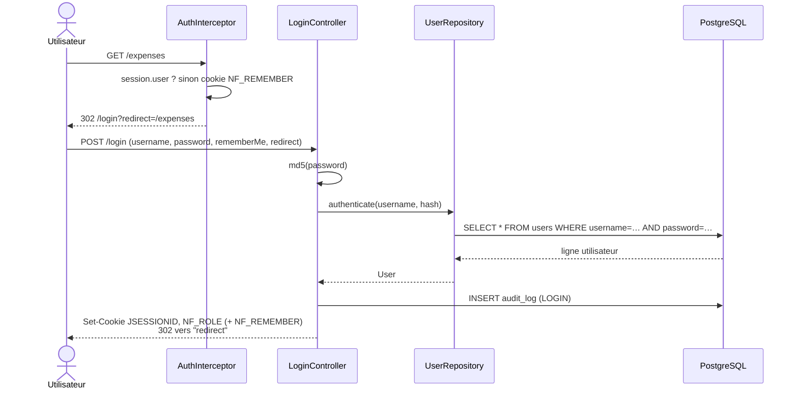
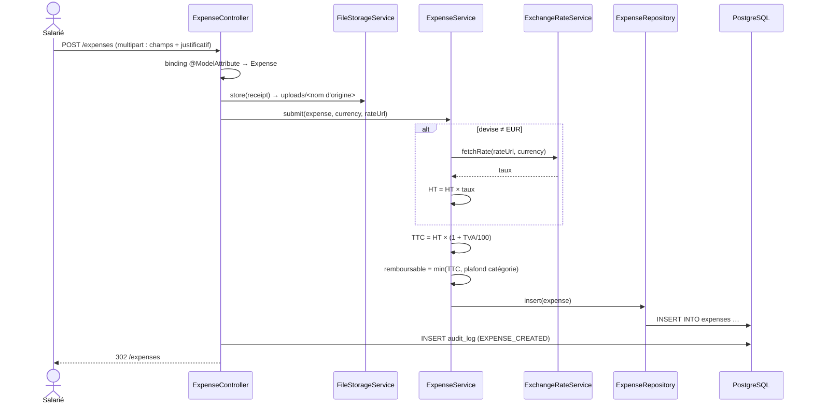
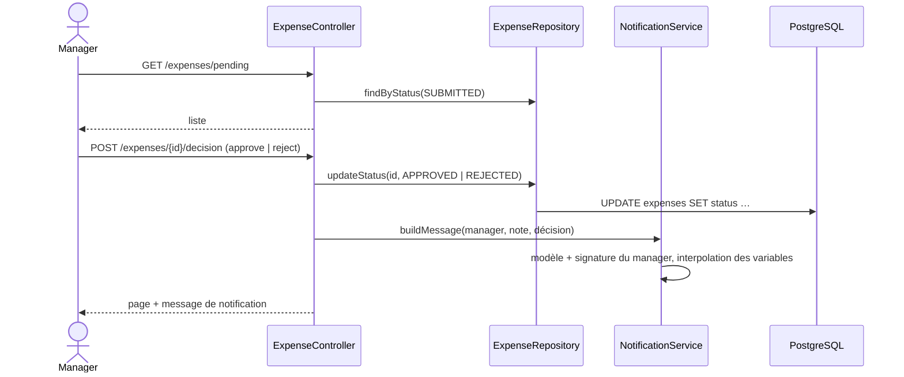
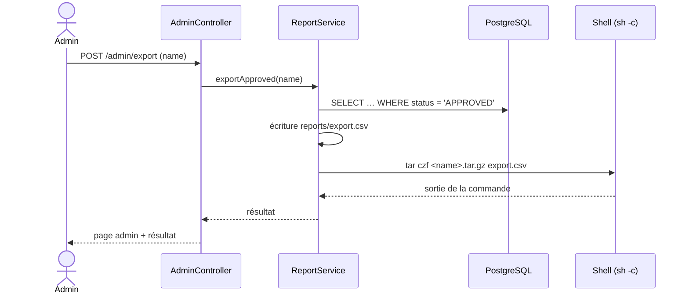
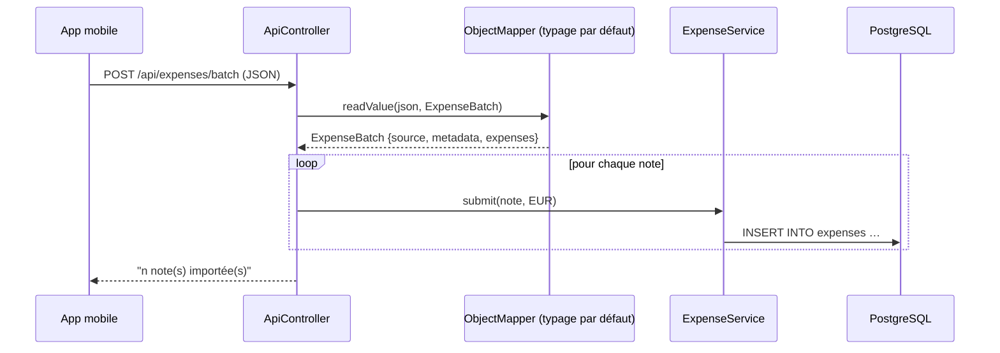

# NoteFrais : documentation technique

## 1. Objet

NoteFrais permet aux salariés de déclarer leurs notes de frais, aux managers de les valider et aux
administrateurs de produire les exports comptables. L'application est un monolithe web Java
(rendu côté serveur) adossé à une base PostgreSQL, packagé en WAR et déployé sur un Tomcat externe.

### Pile technique

| Couche | Composant | Version |
|---|---|---|
| Langage / JVM | Java (Eclipse Temurin) | 17 |
| Serveur d'applications | Apache Tomcat (WAR `ROOT.war`) | 9.0.60 |
| Framework | Spring Boot / Spring Framework | 2.6.5 / 5.3.17 |
| Vues | Thymeleaf + thymeleaf-spring5 | 3.0.11 |
| Sérialisation JSON | Jackson databind | 2.10.0 |
| Journalisation | Log4j 2 (via SLF4J) | 2.14.1 |
| Accès aux données | Spring JDBC (JdbcTemplate), driver PostgreSQL | 42.3.1 |
| Base de données | PostgreSQL | 11.15 |
| Utilitaires | Apache commons-text / commons-collections | 1.9 / 3.2.1 |

## 2. Schéma d'architecture



### Déploiement



## 3. Organisation du code

```
src/main/java/com/formation/notefrais/
├── NoteFraisApplication.java      point d'entrée Spring Boot (exécution autonome)
├── ServletInitializer.java        démarrage dans un Tomcat externe (WAR)
├── config/
│   ├── AuthInterceptor.java       authentification, cookie "se souvenir de moi", accès /admin
│   ├── WebConfig.java             enregistrement de l'intercepteur, CORS de l'API
│   └── GlobalExceptionHandler.java page d'erreur
├── controller/                    couche web (pages Thymeleaf + API REST)
├── service/                       logique métier et intégrations (fichiers, shell, HTTP, XML)
├── repository/                    accès PostgreSQL via JdbcTemplate
├── model/                         User, Expense, ExpenseBatch, RememberMeToken
└── util/                          HashUtil (MD5, jetons), CookieSerializer
src/main/resources/
├── application.properties         configuration (datasource, session, actuator…)
├── db/schema.sql, db/data.sql     schéma et jeu de données
├── templates/                     vues Thymeleaf (dont help/fr.html, help/en.html)
└── static/css/style.css
```

## 4. Modèle de données



## 5. Points d'entrée HTTP

| Méthode | URL | Contrôleur | Description |
|---|---|---|---|
| GET/POST | `/login` | LoginController | Formulaire et traitement de connexion |
| GET | `/logout` | LoginController | Déconnexion |
| GET/POST | `/reset`, `/reset/confirm` | LoginController | Mot de passe oublié (code à 6 chiffres) |
| GET | `/` | DashboardController | Récapitulatif mensuel |
| GET | `/expenses?q=&sort=` | ExpenseController | Liste / recherche des notes de l'utilisateur |
| GET | `/expenses/new` | ExpenseController | Formulaire de saisie |
| POST | `/expenses` | ExpenseController | Création (multipart, justificatif) |
| GET | `/expenses/{id}` | ExpenseController | Détail d'une note |
| GET | `/expenses/{id}/delete` | ExpenseController | Suppression |
| GET | `/expenses/receipt?file=` | ExpenseController | Téléchargement d'un justificatif |
| GET | `/expenses/pending` | ExpenseController | File de validation (managers) |
| POST | `/expenses/{id}/decision` | ExpenseController | Approbation / refus + notification |
| GET/POST | `/profile` | ProfileController | Email, IBAN, signature |
| GET | `/help?lang=` | HelpController | Aide en ligne (vue `help/<lang>`) |
| GET | `/admin` | AdminController | Utilisateurs, journal d'audit |
| POST | `/admin/export` | AdminController | Export CSV archivé en .tar.gz |
| POST | `/admin/import` | AdminController | Import XML de notes |
| GET | `/admin/check-url?url=` | AdminController | Test du service de taux |
| POST | `/admin/check-db` | AdminController | Test de connexion JDBC à la base de l'ancien outil |
| GET | `/api/expenses?userId=&q=&sort=` | ApiController | Notes d'un utilisateur (JSON) |
| POST | `/api/expenses/batch` | ApiController | Réception d'un lot de notes (JSON, voir 6.6) |
| GET | `/api/users/{id}` | ApiController | Fiche utilisateur (JSON) |
| GET | `/actuator/**` | Spring Actuator | Supervision |

## 6. Diagrammes de flux

### 6.1 Flux global (vue utilisateur)



### 6.2 Authentification



### 6.3 Saisie et traitement d'une note de frais



### 6.4 Validation par un manager



### 6.5 Export comptable (administrateur)



### 6.6 Synchronisation par lot (application mobile)



Format attendu (le typage par défaut de Jackson impose d'indiquer le type des champs non concrets) :

```json
{
  "source": "mobile-2.4",
  "metadata": ["java.util.HashMap", {"device": "Pixel 8"}],
  "expenses": ["java.util.ArrayList", [
    {"userId": 3, "expenseDate": "2026-11-19", "category": "TRANSPORT",
     "description": "Métro", "amountHt": 1.90, "vatRate": 10}
  ]]
}
```

## 7. Configuration

| Propriété | Rôle | Défaut |
|---|---|---|
| `DB_URL`, `DB_USER`, `DB_PASSWORD` | Connexion PostgreSQL | `jdbc:postgresql://localhost:5432/notefrais` |
| `UPLOAD_DIR` | Dossier des justificatifs | `./uploads` |
| `REPORT_DIR` | Dossier des exports | `./reports` |
| `spring.sql.init.mode=always` | Recrée le schéma au démarrage | — |
| `spring.mvc.format.date=iso` | Format des dates saisies (AAAA-MM-JJ) | — |
| `management.endpoints.web.exposure.include` | Endpoints Actuator exposés | `*` |
